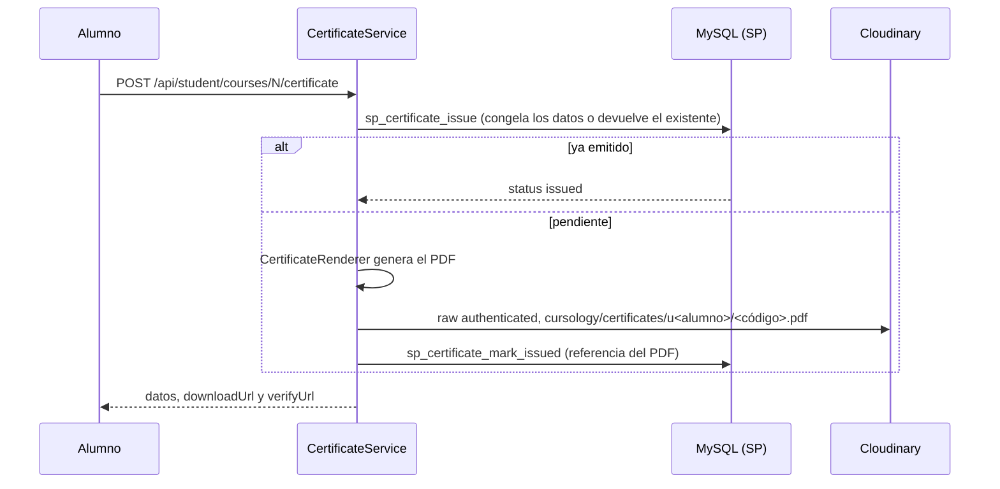

# Certificados

Cuando un alumno termina un curso (todos sus niveles; ver "Reproductor y avance" en [api.md](api.md)), puede obtener su certificado en PDF. Cualquiera puede comprobar con el código impreso que el certificado es auténtico.

## Cómo se emite



- **Uno por alumno y curso.** Se genera la primera vez que el alumno lo pide, con "Obtener certificado" en el reproductor o en "Mi aprendizaje". Pedirlo otra vez devuelve el mismo.
- **Si falla la subida a Cloudinary**, el certificado queda pendiente y el siguiente intento lo vuelve a generar con los mismos datos y el mismo código.
- **Datos congelados** al crearlo, en la tabla `certificate`:
  - el nombre del alumno;
  - el título del curso;
  - el certificador: el "Nombre en el certificado" del curso o, si está vacío, el nombre del instructor;
  - la fecha en que terminó;
  - la plantilla (`cursology-v1`).

  Si después cambian el nombre del alumno o el título del curso, el certificado no cambia. Tampoco se pierde si el curso se da de baja.

## El PDF

- Lo genera `App\Services\Pdf\PdfDocument`, un escritor mínimo de PDF 1.4 en PHP puro, sin librerías.
- Usa las fuentes estándar Helvetica y Helvetica-Bold con WinAnsiEncoding: los acentos, la ñ, ¿ y ¡ se ven bien. Lo que no existe en esa codificación (por ejemplo, emojis) sale como `?`.
- El diseño fijo (`App\Services\CertificateRenderer`, en A4 horizontal) tiene:
  - un marco doble;
  - "Cursology" y "CERTIFICADO DE FINALIZACIÓN";
  - el nombre del alumno;
  - el título del curso;
  - quién certifica y la fecha en que terminó, en la hora de México ("23 de octubre de 2026");
  - abajo, el código y la dirección de verificación.
- Los textos largos se reducen de tamaño para caber; si ni así caben, se recortan con "...".

## Descarga

- `GET /api/student/certificates/{id}/download`, solo para el dueño. El servidor baja el PDF de Cloudinary con una URL firmada y lo entrega como `application/pdf` con el nombre `Certificado - <curso>.pdf`.
- El PDF en Cloudinary es `authenticated`: sin firma no se puede descargar. La ruta de la app no caduca, a diferencia de las URL firmadas.

## Verificación

- El PDF imprime el código (UUID) y la dirección `<APP_URL>/?view=verify&code=<código>`.
- La página `?view=verify` es pública. Al abrirla con un código ya muestra el resultado:
  - **"Certificado válido"**, con a quién se otorgó, el curso, quién certifica, cuándo terminó, cuándo se emitió y el código;
  - **"No encontramos ningún certificado con ese código"** (404).

  El botón "Verificar" sirve para revisar otro código. Se acepta en mayúsculas o con espacios alrededor.
- También está `GET /api/certificates/verify?code=`, que devuelve solo los datos públicos, sin la descarga.
- La verificación sirve a quien **recibe** el certificado (un empleador, un profesor): el PDF se puede editar, pero los datos de la página salen de la base.

## `APP_URL`

En el `.env` (opcional):

```
APP_URL=http://localhost:8000
```

Es la dirección pública de la app, sin `/` final, que se imprime en el enlace de verificación. Si está vacía, se usa la dirección con la que se abrió la página (protocolo, host y carpeta).

Ponla si la app se abre con una dirección distinta de la que verán quienes reciben el certificado, por ejemplo detrás de un proxy o con un dominio propio. La dirección queda impresa en el PDF al emitirlo y no cambia después.

## Pruebas

- `php tests/verify_certificate_unit.php`: estructura del PDF, WinAnsi, anchos y ajuste, diseño, nombre del archivo y validaciones.
- `php tests/verify_certificate_db.php`: emitir, reintentar si falla la subida, datos congelados, descarga solo del dueño, verificación, opiniones y moderación. Usa un almacén falso en lugar de Cloudinary.
- `php tests/verify_cloudinary_live.php`: sube el PDF real como `raw` `authenticated`, comprueba que sin firma no se descarga y que el servidor lo baja tal cual, y lo borra.
