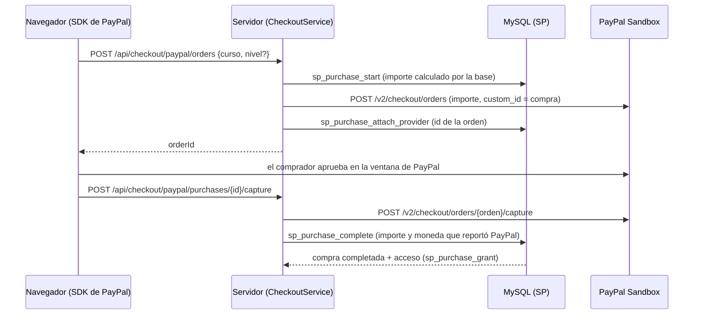

# Pagos de prueba: PayPal Sandbox y tarjeta simulada

Cursology **no cobra dinero real**. Hay dos formas de pago:

- **PayPal (Sandbox):** llamadas reales a la API de PayPal Developers, pero en su entorno de pruebas, con cuentas y dinero ficticios.
  - La dirección `https://api-m.sandbox.paypal.com` está fija en `App\Integrations\PayPalClient`.
  - No existe ninguna configuración para apuntar a Live.
- **Tarjeta simulada:** valida los datos de la tarjeta en el servidor y nunca cobra.

## 1. Crear la app de Sandbox (una sola vez)

1. Entra a [developer.paypal.com](https://developer.paypal.com) con tu cuenta de PayPal. Cualquier cuenta personal sirve: en Sandbox no se cobra nada.
2. Ve a **Apps & Credentials** y deja el interruptor de arriba en **Sandbox** (no en Live).
3. Haz clic en **Create App**:
   - nombre: `Cursology`;
   - tipo: **Merchant**;
   - cuenta: la **Sandbox Business Account** que PayPal crea por omisión, o una de México (paso 2).
4. Copia el **Client ID** y el **Secret** (botón *Show*).
5. Pégalos en el `.env`, que no se sube al repositorio:

   ```
   PAYPAL_SANDBOX_CLIENT_ID=<Client ID de Sandbox>
   PAYPAL_SANDBOX_CLIENT_SECRET=<Secret de Sandbox>
   ```

6. Comprueba la conexión:

   ```powershell
   php tests/verify_paypal_live.php
   ```

   Debe terminar en `RESULTADO: OK`: obtiene el token, crea una orden de $1.00 MXN y la lee en estado `CREATED`. La orden no se paga y PayPal la descarta sola.

## 2. Cuentas de prueba

En **Testing Tools → Sandbox Accounts**, PayPal ya tiene dos cuentas ficticias:

| Cuenta | Para qué |
|---|---|
| **Business** | La tienda (Cursology). Recibe los pagos de la app que creaste. |
| **Personal** | El comprador. Con su correo y contraseña inicias sesión en la ventana de PayPal al pagar. |

- La contraseña de la cuenta Personal se ve en los tres puntos → *View/Edit account*. Su saldo es dinero de prueba.
- **Recomendado: una cuenta Business de México**, porque los cursos se cobran en **MXN**.
  - Créala con *Create account* → *Business* → país *Mexico*, y elígela al crear la app.
  - Con una Business de otro país, PayPal puede dejar el cobro en MXN como **pendiente de aceptar**. Cursology lo trata como compra pendiente y no da acceso; ver "Problemas comunes".
- Si quieres un comprador mexicano, crea otra cuenta *Personal* con país *Mexico*.

## 3. Activar las formas de pago

Como admin, entra a **Formas de pago** (`?view=payment-methods`) y activa **PayPal (Sandbox)** y/o **Tarjeta simulada**.

- PayPal solo aparece como *lista* si el `.env` tiene las dos credenciales.
- Sin ellas no se ofrece en el pago, aunque esté activa.
- Una forma inactiva no aparece en el pago, y la API responde `409 PAYMENT_METHOD_UNAVAILABLE`.

## 4. Probar una compra

1. Inicia sesión como **alumno** y abre un curso de paga del catálogo.
2. Elige **Comprar el curso completo** o **Comprar este nivel** en el temario. Llegas a `?view=checkout`.
3. Paga de una de estas formas:
   - **PayPal:** haz clic en el botón de PayPal. En la ventana de `sandbox.paypal.com`, entra con la cuenta **Personal** de prueba y confirma.
   - **Tarjeta simulada:**

     | Número | Resultado |
     |---|---|
     | `4242 4242 4242 4242` | Se aprueba |
     | `4000 0000 0000 0002` | Siempre se rechaza (`CARD_DECLINED`) |

     Con cualquier titular, vencimiento futuro (`MM/AA`) y CVV de 3 o 4 dígitos.
4. Al completarse, Cursology te lleva al reproductor del curso. La compra aparece en **Mi aprendizaje → Mis compras**.
5. Opcional: el pago se ve en [sandbox.paypal.com](https://www.sandbox.paypal.com), entrando con la cuenta Business de prueba.

## Cómo funciona PayPal



- **El importe lo calcula la base**, no el navegador. Al capturar se exige que PayPal haya cobrado exactamente ese importe y moneda (`PAYMENT_MISMATCH` si no).
- **No hay transacción abierta durante las llamadas a PayPal.**
- **Idempotencia:**
  - `PayPal-Request-Id` (`cursology-order-<compra>` y `cursology-capture-<orden>`) evita órdenes o cobros dobles si una llamada se repite.
  - Si la orden ya estaba capturada, se lee y se usa esa captura.
  - `uq_purchase_provider` impide usar la misma orden en dos compras.
- **Resultados de la captura:**
  - `COMPLETED` → acceso;
  - `PENDING` → la compra sigue pendiente (`202`);
  - `DECLINED` u otro → la compra queda `failed` (`402 PAYMENT_DECLINED`).
  - Si el comprador cierra la ventana, la compra queda `cancelled`.
- El Client ID es público (lo usa el SDK de JS). El Secret solo vive en el servidor y nunca aparece en respuestas, logs ni `var_dump`.

## Tarjeta simulada

- `CardValidator` revisa:
  - el titular;
  - el número: de 13 a 19 dígitos y el algoritmo de Luhn;
  - el vencimiento: vence al terminar el mes;
  - el CVV: 3 o 4 dígitos.
- La compra se abre con `sp_purchase_start` y se completa con la transacción `SIM-<12 hex>-<últimos 4 dígitos>`.
- **El número completo y el CVV nunca se guardan ni se devuelven.**

## Problemas comunes

| Síntoma | Causa y solución |
|---|---|
| PayPal no aparece en el pago, o `503 PAYMENTS_UNAVAILABLE` | Faltan `PAYPAL_SANDBOX_CLIENT_ID` o `PAYPAL_SANDBOX_CLIENT_SECRET`, o PayPal está inactiva en *Formas de pago*. |
| `502 PAYMENT_PROVIDER_FAILED` y en el log `[payments] ... no se obtuvo el token (HTTP 401)` | Credenciales mal copiadas o de **Live**. Usa las de la pestaña **Sandbox**. |
| `[payments] ... HTTP 422: CURRENCY_NOT_SUPPORTED` | La cuenta Business no acepta MXN: usa una Business de México. |
| La compra queda **pendiente** después de pagar (`202`) | PayPal dejó el cobro por aceptar (por ejemplo, una Business de otro país recibiendo MXN). Usa una Business de México o acepta el pago desde `sandbox.paypal.com`. |
| `[payments] ... unable to get local issuer certificate` | Proxy con inspección TLS (Zscaler). Igual que con Cloudinary: ver [media.md](media.md), "Certificados detrás de un proxy (Zscaler)". |
| Los botones de PayPal no cargan | El navegador no pudo descargar `https://www.paypal.com/sdk/js`; revisa la red o un bloqueador. Esa dirección es la misma para Sandbox: el Client ID decide el entorno. |
